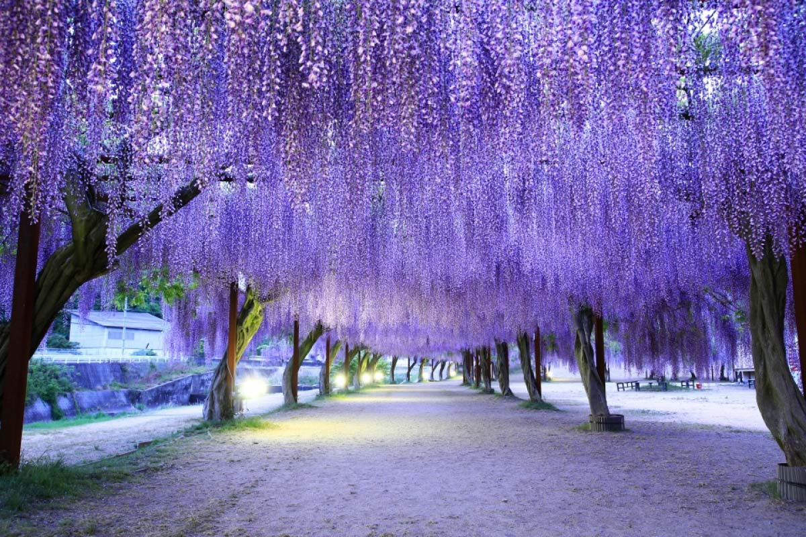
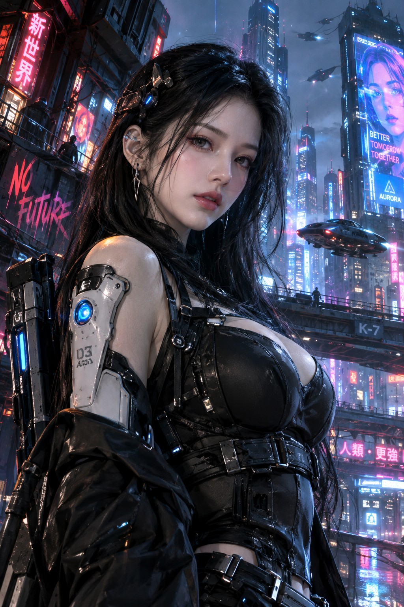
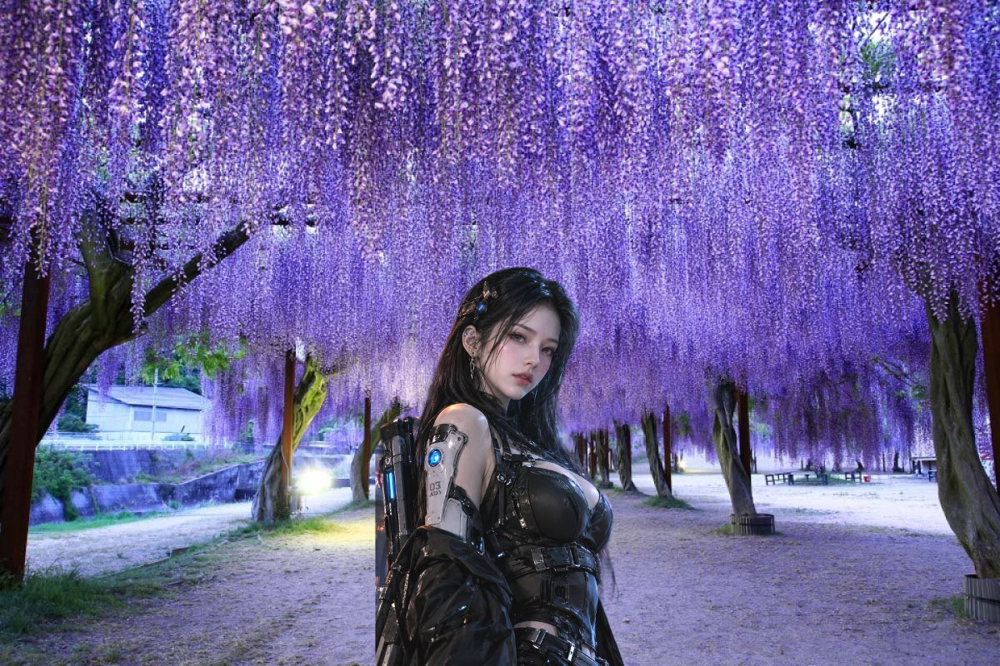
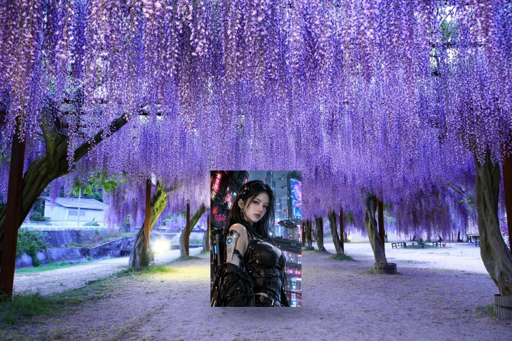
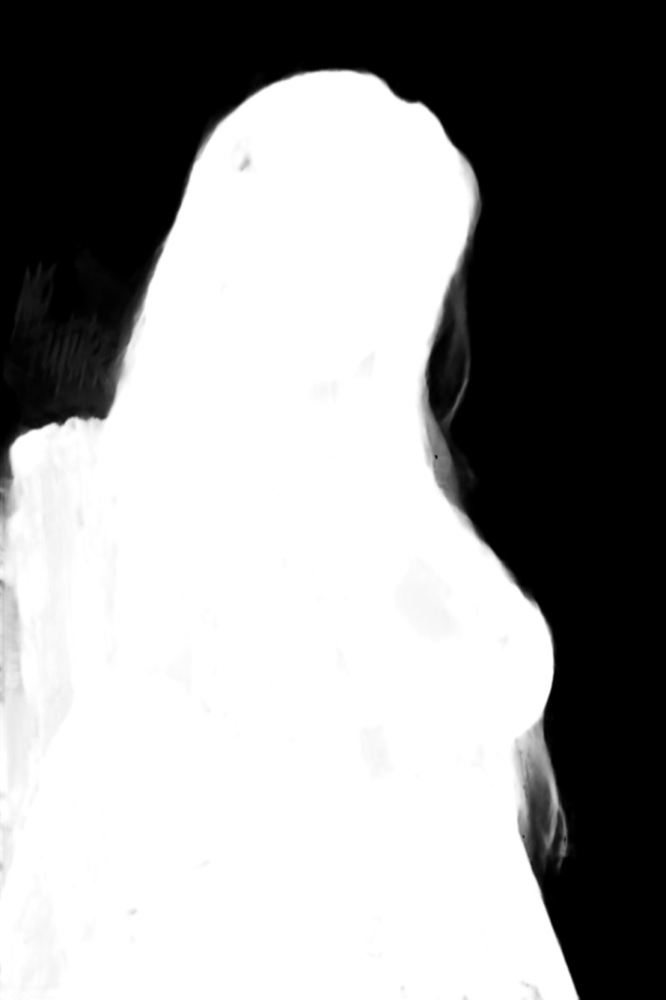
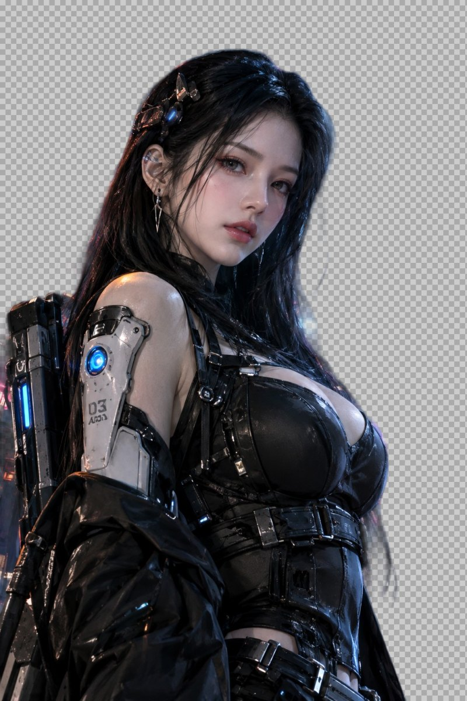
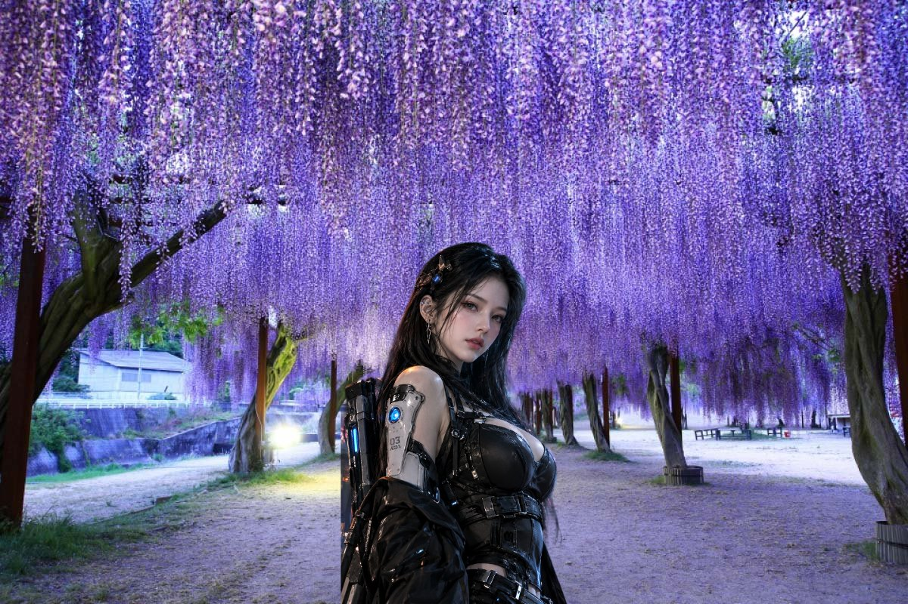
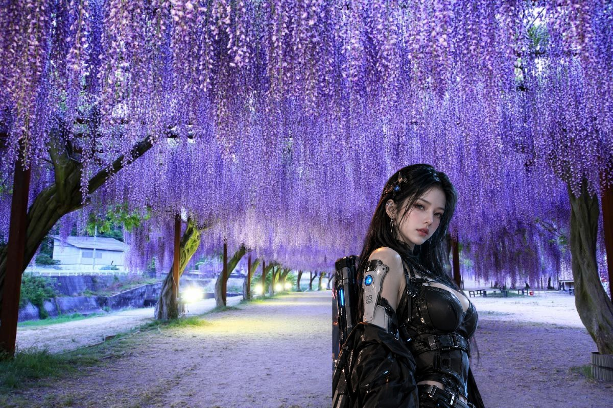

# AI Auto Composite Studio 使用手冊

把一張人物圖合成到背景照片裡：程式自動去背、推薦位置與大小、匹配色彩與陰影，你再依需要微調，最後以背景原始解析度輸出。

- 程式位置：`C:\專案\AutoComposite`
- 執行：`dotnet run --project AutoComposite.App -c Release`，或用 Visual Studio 開 `AutoComposite.sln`，把 AutoComposite.App 設為啟動專案後按 F5。
- 程式裡的教學：工具列的「**📖 使用教學**」。第一次啟動時程式也會主動詢問要不要開啟。

---

## 第一部分：引導式教學

這一部分跟程式裡的「📖 使用教學」視窗內容相同，用兩張範例圖片走完一次完整的合成：

| 背景：紫藤花隧道 | 人物：賽博龐克女戰士（半身像） |
|---|---|
|  |  |

完成後會得到這張：



> 教學裡的示意圖是用程式本身的合成核心（`tools/TutorialImages`）跑出來的。產生示意圖時，去背用的是 IS-Net anime 模型；你實際使用 ToonOut 時，邊緣細節會略有不同。

### 步驟 1：下載去背模型

程式不附 AI 模型（檔案大、各有授權），第一次使用要先下載。

1. 按工具列的「**模型管理**」。
2. 選「**BiRefNet ToonOut（動漫人物去背）**」，按「**下載安裝**」。
3. 下載前會顯示檔案清單、大小與授權，閱讀後確認。
4. 下載完程式會自動「測試載入」，出現「載入成功」就完成了。

| 人物類型 | 建議模型 |
|---|---|
| 動漫、插畫、遊戲角色 | BiRefNet ToonOut |
| 真人照片 | BiRefNet（通用去背） |
| 已經是透明背景的 PNG | 不需要模型 |

### 步驟 2：開啟背景照片

在教學視窗按「**使用範例背景**」，或按工具列的「**🖼 開啟背景**」選擇自己的照片。

- 背景會保留原始解析度，最後匯出時，人物以外的地方和原圖完全一樣。
- 左側會顯示尺寸、格式和透明度資訊。
- 超過 6400 萬像素的超大掃描檔會自動等比縮小後再載入，資訊裡會註明原圖尺寸。

### 步驟 3：開啟人物圖片

按「**使用範例人物**」，或按工具列的「**🧍 開啟人物**」。



範例人物是一般圖片，還沒去背，所以剛載入時會整張連原本的城市背景一起蓋在紫藤花上，這是正常的。如果人物圖本來就是透明背景的 PNG，程式會直接使用它的透明度，可以跳過下一步。

### 步驟 4：自動去背

按工具列的「**✂ 自動去背**」。


棋盤格的部分是透明區域，頭髮和肩上的武器都會保留下來。

- **速度**：有獨立顯示卡時使用 DirectML。1024×1536 的圖約 10～20 秒，第一次要多花時間載入模型。
- **記憶體**：記憶體少於 16 GB 的電腦，建議在右側「**去背**」分頁把「執行裝置」改成 **CPU**。
- **模型釋放**：去背模型閒置 90 秒後會自動釋放記憶體，下次去背時再自動載入。

### 步驟 5：檢查與修正遮罩

把工具列的「**預覽**」切到「**去背人物**」或「**Alpha 遮罩**」，檢查人物邊緣。

| Alpha 遮罩（白＝保留） | 修正後 |
|---|---|
|  |  |

範例的左上角留下了一點原背景「NO FUTURE」霓虹招牌的淡紅色殘影。修正方法：

1. 在「**去背**」分頁把「**黑點**」調到 0.15 左右，按「**套用精修**」，淡淡的殘影就會消失。
2. 如果還有殘留，按「**編輯遮罩…**」：
   - 選「**移除筆刷**」，塗掉不要的地方。
   - 頭髮或武器被切掉時，選「**保留筆刷**」補回來。
   - 邊緣太硬時，調高「**邊緣羽化**」。
3. 想從頭再來，按「**還原 AI 遮罩**」，回到剛去背的狀態。

每一筆修改都可以按 Ctrl+Z 復原。

### 步驟 6：自動定位

按工具列的「**📍 自動定位**」。



程式會分析人物的形狀，自動判斷要怎麼放：

| 人物 | 擺放方式 |
|---|---|
| 全身像 | 找可以站的地方，例如對著天空的柱頂或平台，讓腳踩在上面；沒有天空時放在畫面下方中央的地面。 |
| 半身像（下緣被裁切，像範例這樣） | 裁切邊貼齊畫面下緣，高度約畫面 60%，像人像照一樣從畫面底部「長出來」。 |

右側「**定位**」分頁會列出幾個候選位置和評分，例如中央、左三分之一、右三分之一，點一下就能換。

如果想自己決定位置或大小：

- **指定位置**：按「**點選目標錨點**」，在背景上點一下。
- **站在平台上**：按「**拖曳站立面**」，沿著平台左右邊緣拖一條線。
- **仰角透視**：按「**畫參考線**」，沿著柱子左右邊緣各畫一條，程式會推估透視收斂。
- **固定大小**：填好「**目標高度 px**」或「**占畫面高**」，再按一次自動定位。

### 步驟 7：自動融合

按工具列的「**🎨 自動融合**」。


程式會取樣人物附近的背景，輕度調整人物的亮度、對比、飽和度和色溫。在範例裡，人物的色溫會往紫藤花的冷紫色靠攏。

- 調整幅度有上限，動漫的線條和配色會保留，不會被改成照片質感。
- 全身像會自動加上腳下的接觸陰影；半身像沒有踩在地上，不會畫陰影。

在「**色彩**」分頁可以選擇模式：

| 模式 | 效果 |
|---|---|
| 原始風格 | 完全不改變人物 |
| 環境匹配 | 自動融合時的模式。「自動強度」控制往背景靠攏的程度 |
| 自訂調色 | 每個參數自己調 |

### 步驟 8：手動微調



畫布上的操作：

| 操作 | 方式 |
|---|---|
| 移動人物 | 拖曳 |
| 縮放人物 | Shift＋滾輪（或 `+` `-`） |
| 旋轉人物 | Ctrl＋滾輪（或 `[` `]`） |
| 微調位置 | 方向鍵 1 像素；按住 Shift 一次 10 像素 |
| 放大縮小畫面 | 滾輪 |
| 平移畫面 | 中鍵拖曳，或按住空白鍵拖曳 |
| 復原／重做 | Ctrl+Z ／ Ctrl+Y |

### 步驟 9：匯出與儲存

- **匯出圖片**（工具列「💾 匯出圖片」或 Ctrl+E）：可以存成 PNG（無損）或 JPEG。程式會以背景原始解析度從原圖重新合成，不會放大預覽圖。
- **儲存專案**（Ctrl+S）：存成 `.acsp.json`，記錄所有參數；遮罩另存在「專案名_files」資料夾。下次開啟可以接著修改。

完成！之後換成自己的圖片，流程都一樣：

**開啟背景 → 開啟人物 → 自動去背 → 檢查遮罩 → 自動定位 → 自動融合 → 微調 → 匯出**

---

## 第二部分：功能說明

### 主視窗

- **左側**：背景與選取人物的縮圖和資訊，以及「編輯遮罩／指定人物錨點」按鈕。
- **中央**：合成畫布。
- **右側**：設定分頁。
- **底部**：狀態列，顯示進度、取消按鈕、游標座標、縮放比例。
- **工具列的「預覽」**可以逐步檢視合成的每個環節：

| 預覽 | 顯示內容 |
|---|---|
| 原始背景 | 背景原圖 |
| 去背人物 | 去背後的人物（棋盤格底） |
| Alpha 遮罩 | 白＝保留、黑＝移除 |
| 變換結果 | 人物在背景上的位置（不含背景） |
| 陰影 | 背景加上陰影，不含人物 |
| 最終合成 | 完整結果 |

### 右側分頁

| 分頁 | 內容 |
|---|---|
| 圖層 | 人物清單（上面的在最上層）、顯示／鎖定、上移／下移／刪除、替換人物圖、不透明度、人物錨點種類 |
| 去背 | 模型、執行裝置（自動／DirectML／CPU）、前處理（保留比例補邊／拉伸成正方形）、遮罩精修（黑點、白點、內縮外擴、邊緣羽化、移除碎塊） |
| 定位 | 目標錨點、站立面、參考線、推薦站立點、目標高度、自動定位與候選位置 |
| 變換 | 位置、縮放、旋轉、水平比例、翻轉、透視（仰角梯形收斂、四角自由透視） |
| 色彩 | 模式、自動強度、亮度、對比、飽和度、色溫、色調、RGB 增益、Gamma、混合強度、景深模糊 |
| 陰影 | 投射陰影（方向、長度、地面壓扁、偏移、模糊、不透明度、縮放、距離衰減、顏色）、接觸陰影、環境遮蔽、陰影可以落在哪裡 |
| 遮擋 | 用筆刷繪製遮罩：前景物件（擋在所有人物前面）、只擋選取的人物、保護區域、陰影接收區域 |
| 輸出 | JPEG 品質、預覽解析度、AI 局部修補（第二階段，目前停用）、效能報告、警告與錯誤紀錄 |

### 前後遮擋

程式不會自動判斷誰在前、誰在後。例如紫藤花串垂在人物前面時：

1. 切到「**遮擋**」分頁，遮罩種類選「**前景物件**」。
2. 按「**🖌 繪製遮罩**」，在畫布上塗出花串。左鍵加入、右鍵減去。
3. 塗到的地方會擋在人物前面。「遮擋羽化」可以讓邊緣柔和一點。

### 模型管理

- 下載前，程式會向 Hugging Face 取得實際的檔案清單和授權。
- 下載可以取消；網路中斷後會從斷點續傳。下載完會驗證 SHA-256。
- 第一次安裝時會鎖定模型版本，之後不會自動升級。
- 選「**商業用途**」時，非商業授權的模型會被擋下。
- 「**測試載入**」會顯示模型的輸入輸出規格，以及實際使用的是 DirectML 還是 CPU。

---

## 常見問題

**去背結果只剩下邊緣，或整張都被當成背景？**
有些模型不接受補邊的輸入。到「去背」分頁把「前處理」改成「**拉伸成正方形**」，再去背一次。

**去背很慢，或記憶體不足？**
在「去背」分頁把執行裝置改成 **CPU**。DirectML 推論時，顯示卡驅動會多佔約 9 GB 記憶體。

**載入很大的圖片？**
超過 6400 萬像素的圖片會自動等比縮小載入（例如 30000×23756 的《星夜》會縮成約 8990×7118），左側資訊會註明原圖尺寸。

**人物位置不對？**
自動定位只是根據單張照片推估，不是 3D 重建。用「點選目標錨點」或「拖曳站立面」告訴程式要放哪裡，或直接在畫布上拖曳。

**陰影方向不對？**
光源方向只能粗略估計。請在「陰影」分頁依照片的實際光線調整「方向」。

**想重新看一次教學？**
按工具列的「📖 使用教學」。

---

## 範例圖片與示意圖

- `Docs/tutorial/sample-background.jpg`、`sample-figure.jpg`：教學用的範例圖片。若要散布程式，請先確認這兩張圖的使用權。
- 其餘 `step*.jpg`：由 `tools/TutorialImages` 用 AutoComposite.Core 實際跑合成流程產生。重新產生的方法：

```powershell
cd C:\專案\AutoComposite
dotnet run --project tools/TutorialImages -c Release -- 背景.png 人物.png isnet-anime.onnx 輸出資料夾
```

產生示意圖需要 IS-Net anime 模型（`isnet-anime.onnx`，Apache-2.0）。模型可以從 rembg 的 GitHub releases 下載，不放進 git。
